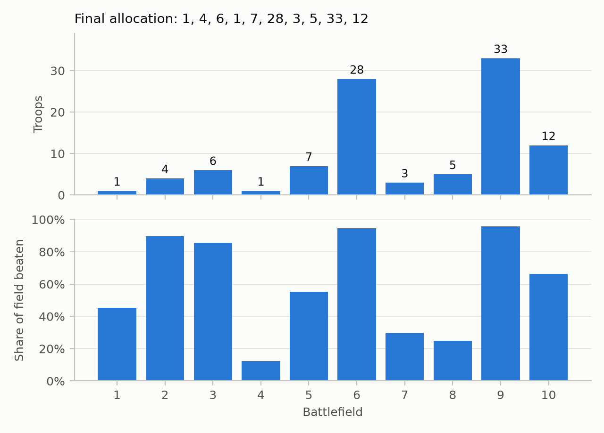
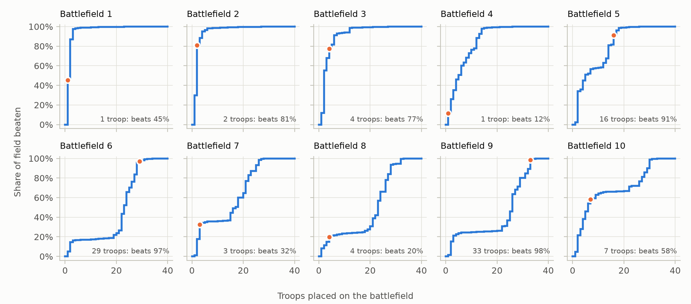
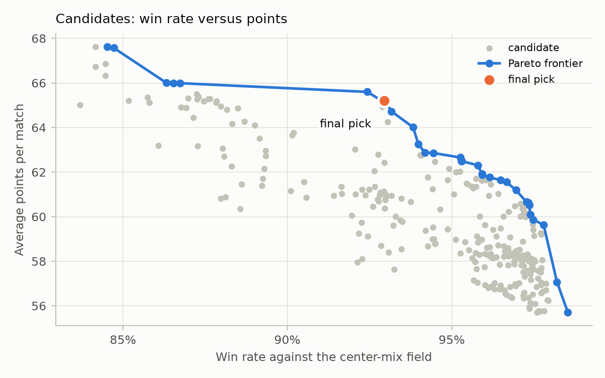
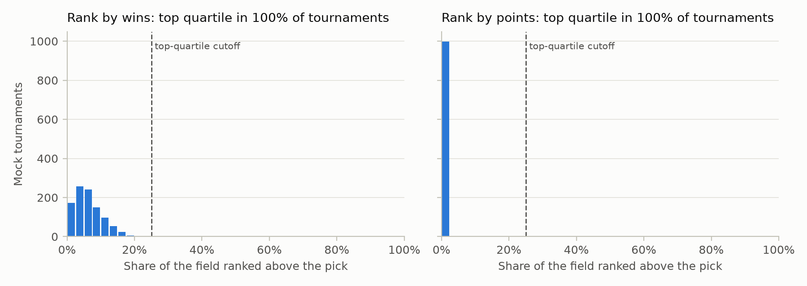

# Maroon Capital Challenge 2026

A computational strategy for the Maroon Capital 2026 challenge problem, a Colonel Blotto variant.
Each player splits 100 troops across 10 battlefields worth 1 to 10 points.
Bonus multipliers reward adjacent wins, base scores that are multiples of 5, and winning battlefield 6.
The full problem statement is in [`docs/problem.md`](docs/problem.md).

## Approach

1. Score every possible outcome exactly with a 1,024-entry lookup table.
2. Build a simulated applicant pool: real Riddler submissions, rules of thumb, chatbot answers, random splits, and counters that best-respond to the rest of the pool.
3. Search for the strongest allocations with simulated annealing and a steepest-ascent polish.
4. Pick the candidate with the best worst case when a pessimist chooses the pool mix and the wins-versus-points weighting.
5. Validate the pick with 1,000 mock tournaments, a held-out run, and a counter check.

The design is in [`docs/specs/`](docs/specs/), and the build plan is in [`docs/plans/`](docs/plans/).

## Results

The current pick is `[0, 0, 0, 0, 15, 28, 1, 1, 33, 22]`.
Chatbot answers are still being collected, so this pick will be regenerated once they are in.
The numbers for every finalist are in [`results/summary.json`](results/summary.json).









## Usage

```bash
uv sync
uv run pytest
uv run python scripts/run_pipeline.py
uv run python scripts/run_pipeline.py --quick --out .smoke/results
```

The full run takes about 5 minutes; the `--quick` run is a smoke test with tiny settings.

## Data

`data/riddler/` holds FiveThirtyEight's Riddler castle submissions, used under the Creative Commons Attribution 4.0 International License.
`data/chatbots/answers.csv` holds chatbot answers to the problem, collected as described in [`data/chatbots/README.md`](data/chatbots/README.md).
